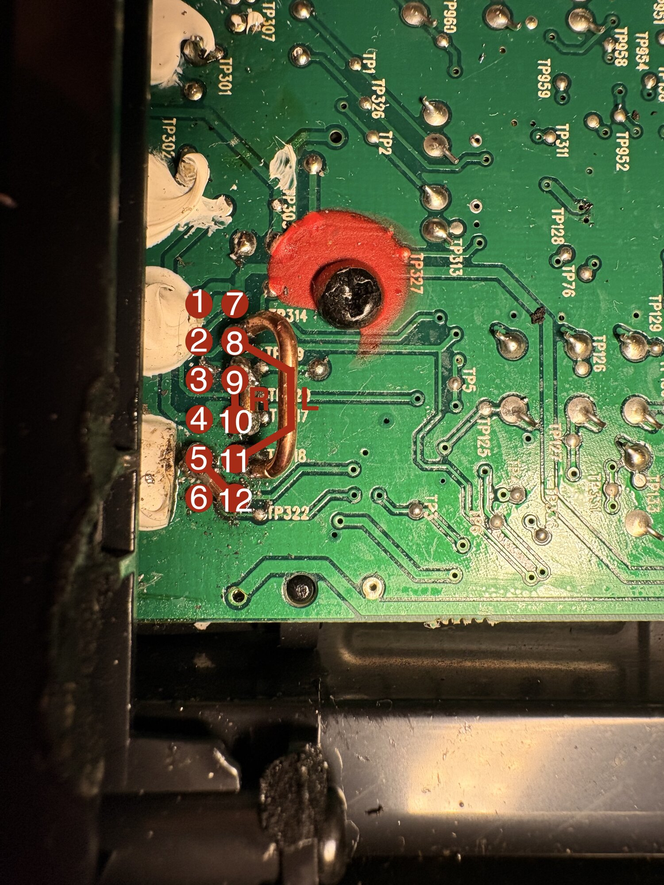

# Bose Companion 3 Series II: control pod bypass (12-pin)

Run a Bose Companion 3 **Series II** without its control pod by bridging three pairs of pins on the back of the 12-pin pod connector inside the bass module. Useful when the pod is broken, crackles, or is mechanically worn out, and a replacement pod is too expensive.

After the bypass, the system runs at fixed full volume and you control the volume from your computer. The Bass Compensation knob on the back keeps working.

> **This guide is for the square 12-pin "To Control Pod" port.** The round 9-pin version uses different pins.


The pin numbers used in this guide, as seen looking into the "To Control Pod" port from outside (unit lying on its side, as in the photo above). The plug on the pod cable is the mirror image of this. It has **no contacts at pins 1 and 3**, so those two are unused:


## What you need

- Phillips screwdriver
- Soldering iron and solder
- A few cm of wire (a piece of solid copper wire works well)

## Safety first

- **Unplug the power cord** before opening anything. Wait a few minutes so the power supply capacitors can discharge.
- **Set your computer volume low** before the first power-on. There is no volume control between the computer and the amp anymore.

## 1. Open the bass module

Remove the **10 screws** on the back panel:

- **4 along the top edge of the panel.** These are hidden under the label sticker. Feel for them and cut or peel the sticker at those spots.
- **2 at the top of the heatsink**, one in each corner.
- **4 along the bottom of the heatsink.**

Then pull the whole back panel (with the heatsink) straight out a few centimetres. The amplifier board is attached to it and comes out with it, **solder side up**. Cables stay connected to the rest of the unit, so don't yank it all the way out.


## 2. Find the 12-pin connector

The connector sits right behind the "To Control Pod" port, at the edge of the board next to the panel. Since it's a right-angle connector, what you see from above are its 12 solder legs: two rows of six, running parallel to the back panel.

Number them as you see the board from above after pulling the panel out:

- **Pins 1 to 6** are the row **closest to the back panel**.
- **Pins 7 to 12** are the row further inside.
- **Pins 1 and 7** are at the end next to the screw marked with **red paint** (labelled TP327 on the board).
- **Pin 12** is next to the **TP322** label.



```
   back panel side
       |
       v
       1    7     <- next to the red-painted screw
       2    8
       3    9
       4   10
       5   11
       6   12     <- next to TP322
```

> Other guides may number the pins from the opposite side, so their top row is our bottom row. Go by the landmarks and the photo, not the numbers alone.

## 3. Bridge the pins

| Bridge  | Function                                       |
| ------- | ---------------------------------------------- |
| 8 to 11 | Left channel                                   |
| 9 to 10 | Right channel                                  |
| 5 to 12 | Turns the amp on (stands in for the pod)       |

**Alternative to 5 to 12:** [this Reddit post](https://www.reddit.com/r/bose/comments/17eyds2/bypass_c50_on_companion_3_series_ii_subwoofer/) uses **2 to 7** instead (converted to this guide's numbering), and that also works. Most likely pins 2 and 5 carry the same signal, as do 7 and 12. Use **one or the other, not both**: if they turn out to be different signals, bridging both would connect two circuits that were never meant to be connected.

In the photos, 8 to 11 is the larger copper loop, 9 to 10 is a solder bridge between the two neighbouring legs, and 5 to 12 is a short piece of wire.


Check that no solder blob touches a neighbouring leg, then slide the panel back in and put the 10 screws back.

## 4. Connect and test

1. Plug your computer into the **From Computer** input with a normal 3.5 mm stereo cable.
2. Set the computer volume low, plug in the power cord and switch the unit on.
3. **Check left and right.** On macOS: System Settings > Sound > Output, drag the balance slider fully left, then fully right. Sound should come from the matching speaker. If it's reversed, your 8/9/10/11 bridges are crossed.

## Note on other guides

This guide is based on [this video](https://www.youtube.com/watch?v=JNieR2Ab0Ck) and [this Reddit post](https://www.reddit.com/r/bose/comments/17eyds2/bypass_c50_on_companion_3_series_ii_subwoofer/). Both bridge **8 to 10 and 9 to 11** (in this guide's numbering), which swaps left and right. Use **8 to 11 and 9 to 10** instead.

## Troubleshooting

- **Left and right swapped:** see step 4.
- **Rattle, hum or buzz with nothing connected:** that comes from the amplifier or speakers, not the pod. This bypass won't fix it.

## Disclaimer

You do this at your own risk. The unit runs on mains power, and wrong connections can damage the amplifier.
